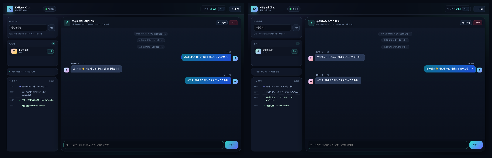
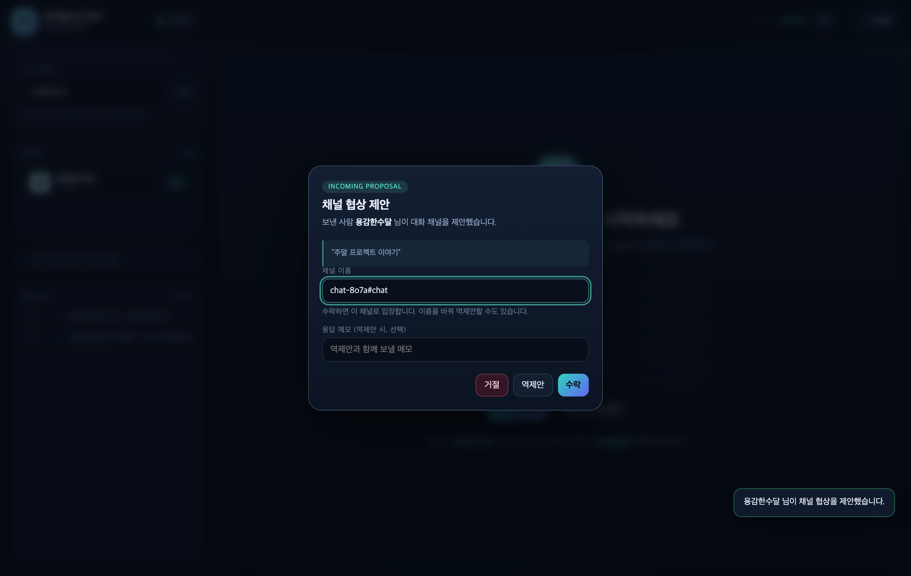
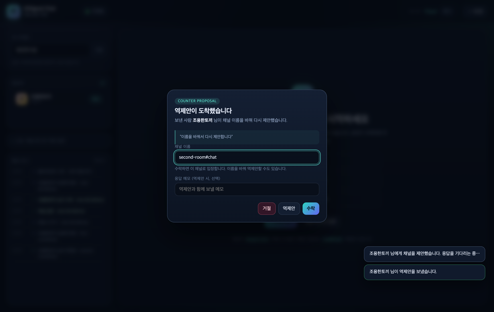

# IOSignal Chat — 채널 협상 채팅 데모

[IOSignal](https://iosignal.net) 7.2.0으로 만든 실시간 채팅 웹앱입니다.
두 개의 브라우저 창이 **채널을 서로 협상(제안 → 수락/거절/역제안)**한 뒤, 합의된
채널에서 메시지를 주고받습니다. 협상 과정은 화면의 **협상 로그**에 그대로 남습니다.

> IOSignal 코드를 새로 만들 때 문서를 다시 읽지 않으려면 **[IOSIGNAL_REFERENCE.md](IOSIGNAL_REFERENCE.md)** 를 먼저 보세요.
> 버전, 태그 문법, API, 쿼터, 검증된 패턴이 한 파일에 정리되어 있습니다.



| 협상 제안을 받은 화면 | 역제안이 도착한 화면 |
| --- | --- |
|  |  |

## 1. 실행

Node.js **22.16.0 이상**이 필요합니다.

```bash
cd iosignal-chat
npm install        # 이미 node_modules 가 있으면 생략 가능
npm start
```

브라우저에서 <http://localhost:5177> 를 엽니다. 웹 페이지와 IOSignal WebSocket 서버가
**같은 포트(5177)** 에서 함께 뜹니다.

```text
[iosignal] WebSocket ready at ws://localhost:5177/ws
[web] http://localhost:5177
```

기존 IOSignal 예제 중 Vanilla JS가 웹 포트 5175를 사용하므로, 이 예제는 충돌을 피해 **5177**을 기본으로 사용합니다.
포트를 바꾸려면 `PORT=8080 npm start` 처럼 실행합니다.

## 2. 두 창으로 대화하기

1. 오른쪽 위 **＋ 새 창**을 누르거나, 같은 주소를 새 창/새 탭에서 한 번 더 엽니다.
   - 창마다 닉네임과 CID가 자동으로 다르게 발급됩니다.
2. 왼쪽 **접속자** 목록에 상대가 나타나면 **협상** 버튼을 누릅니다.
3. 채널 이름(기본값 `chat-xxxx#chat`)과 메모를 적고 **제안 보내기**.
4. 상대 창에 제안 모달이 뜹니다. **수락 / 거절 / 역제안** 중 하나를 선택합니다.
   - **역제안**은 채널 이름을 고쳐서 다시 제안하는 것입니다. 받은 쪽도 다시 수락/거절/역제안할 수 있습니다.
5. 수락되면 양쪽이 자동으로 같은 채널에 입장합니다. 이제 메시지를 입력하고 **Enter**.
6. **태그 복사**로 채널 태그를 복사할 수 있고, **나가기**로 채널에서 나옵니다.

> 협상 없이 바로 입장하려면 왼쪽 **고급: 채널 태그로 직접 입장**에 같은 태그(예: `team#chat`)를
> 입력합니다. 3명 이상도 같은 태그로 입장하면 함께 대화할 수 있습니다.

## 3. 협상 프로토콜

협상은 채널이 아니라 **상대 CID로 보내는 직접 시그널**로 이루어집니다.
모든 메시지는 `B@negotiate` 태그로 전달되고, 수신 측은 `@negotiate` 이벤트로 받습니다.
직접 시그널은 구독이 필요 없습니다.

| type | 보내는 쪽 | 의미 | 주요 필드 |
| --- | --- | --- | --- |
| `propose` | 제안자 → 상대 | 채널 협상 시작 | `id`, `channel`, `note` |
| `counter` | 수신자 → 제안자 | 채널 이름을 바꿔 역제안 | `id`, `channel`, `note` |
| `accept` | 수신자 → 제안자 | 제안(또는 역제안) 수락 | `id`, `channel` |
| `reject` | 수신자 → 제안자 | 거절 | `id` |

```jsonc
// A → B  (B의 CID가 ABC123 이라면 태그는 "ABC123@negotiate")
{
  "v": 1,
  "type": "propose",
  "id": "8f2c…",
  "channel": "chat-epl4#chat",
  "note": "주말 프로젝트 이야기",
  "from": { "cid": "?xFbG", "nick": "수다스러운부엉이" },
  "ts": 1760870000000
}
```

수락이 오면 양쪽이 `channel` 을 `io.subscribe()` 하고, 이후 대화는 그 채널의
`message` 이벤트로 오갑니다. 대화 메시지는 아래 형태의 객체입니다.

```jsonc
{ "kind": "chat", "msgId": "…", "cid": "?xFbG", "nick": "수다스러운부엉이",
  "text": "안녕하세요", "ts": 1760870000000 }
```

입장/퇴장/닉네임 변경은 같은 채널로 `kind: "sys"` 메시지를 보내 알립니다.

## 4. 구조

```text
브라우저 A ── WebSocket ──┐
                          ├── Node HTTP + IOSignal Server (:5177, /ws)
브라우저 B ── WebSocket ──┘
```

| 파일 | 역할 |
| --- | --- |
| `server.mjs` | 정적 파일 서버 + IOSignal `Server` (같은 HTTP 서버, `wsPath: '/ws'`) |
| `public/index.html` | 화면 구조 |
| `public/styles.css` | 다크 테마 UI, 반응형 레이아웃 |
| `public/app.js` | 접속/협상/채팅 로직 (약 1,000줄) |
| `IOSIGNAL_REFERENCE.md` | IOSignal 7.2.0 핵심 요약 — API·태그·제한·검증된 패턴 |
| `public/vendor/io.js` | `node_modules/iosignal` 의 브라우저 IIFE 번들을 서버가 제공 |
| `scripts/smoke.mjs` | Node 클라이언트 2개로 협상·채팅·직접 시그널 검증 |
| `scripts/browser-test.mjs` | 실제 Chrome 두 창으로 수락·대화·역제안 검증 |
| `scripts/browser-edge-test.mjs` | 거절·수동 입장·접속자 이탈·모바일 검증 |

### IOSignal 사용 포인트

**서버** — HTTP 서버를 그대로 넘겨 한 포트로 서비스합니다.

```js
import { Server } from 'iosignal';

const server = http.createServer(staticHandler);
const ioServer = new Server({ httpServer: server, wsPath: '/ws' });
server.listen(5177);
```

**클라이언트** — 접속 후 로비에 인사를 발행하고, 상대 CID로 직접 시그널을 보냅니다.

```js
const io = new IO(`${location.protocol === 'https:' ? 'wss' : 'ws'}://${location.host}/ws`);

io.on('ready', () => {
  io.subscribe('lobby#presence');                 // 채널 구독
  io.signal('lobby#presence', { cid: io.cid, nick }); // 채널 발행
});

io.on('@negotiate', (tag, msg) => { /* 직접 수신: 구독 불필요 */ });
io.signal(`${peerCid}@negotiate`, { v: 1, type: 'propose', /* … */ });

io.on('message', (tag, msg) => { /* 구독한 채널의 메시지 */ });
io.subscribe('chat-epl4#chat');
```

- `listen(tag, handler)` 는 구독 등록 + 핸들러 등록을 한 번에 합니다. 이 앱은 채널을
  동적으로 바꾸므로 `ready` 에서 `subscribe()` / `unsubscribe()` 를 직접 호출합니다.
- 재접속하면 서버 쪽 구독이 사라지므로 `ready` 이벤트마다 로비와 현재 채널을 다시 구독합니다.
- 태그는 UTF-8 기준 **255 bytes** 제한이 있습니다. 채널 이름은 32자로 잘라 씁니다.
- 익명 클라이언트의 기본 `signalSize` 는 **1,500 bytes** 입니다. 한글은 글자당 3 bytes라서
  메시지를 UTF-8 기준 1,100 bytes로 잘라 보냅니다(`clampText`).

## 5. 테스트

```bash
npm test            # Node 클라이언트 2개: ready → 협상 → 채널 대화 → 직접 시그널
npm run test:browser # Chrome 두 창: 제안 → 수락 → 대화 → 역제안 → 합의 채널 대화
npm run test:edge    # 거절 / 수동 채널 입장 / 접속자 이탈 / 모바일
npm run test:all
```

브라우저 테스트는 시스템에 설치된 Chrome을 사용합니다(`playwright-core`, 브라우저 다운로드 없음).
서버가 켜져 있어야 하며, 스크린샷은 `screenshots/` 에 저장됩니다.

## 6. 설정과 한계

- **HTTPS** 로 서비스하려면 TLS 종료 프록시 뒤에 두면 `location.protocol` 에 맞춰
  자동으로 `wss://…/ws` 를 사용합니다.
- **공개 IOSignal 서버**를 쓰려면 `public/app.js` 의 `WS_URL` 을
  `wss://io.iosignal.net/ws` 로 바꾸면 됩니다. 이때는 HTTPS 페이지에서 열어야 합니다.
- 이 데모는 **익명 연결**입니다. 실제 서비스에서는 [인증 설정](https://iosignal.net/docs/server/authentication)과
  TLS를 적용하세요. 채널 태그를 아는 사람은 입장할 수 있으므로 채널 이름을 비밀로 쓰지 마세요.
- 메시지는 서버에 저장되지 않습니다. 새로 입장한 사람은 이전 대화를 볼 수 없습니다.
  마지막 값 유지가 필요하면 `$` 리테인 태그(`room#$state`)를 사용할 수 있습니다.
- 접속자 목록은 20초 하트비트와 70초 TTL로 유지되는 휘발성 정보입니다.
- 협상 대기 시간은 2분이며, 이후에는 만료로 기록됩니다.

## 7. 참고

- [IOSignal 문서](https://iosignal.net/docs)
- [5분 빠른 시작](https://iosignal.net/docs/start/quickstart)
- [시그널 태그](https://iosignal.net/docs/core/signal_tags)
- [클라이언트 API](https://iosignal.net/docs/reference/client-api)
- [GitHub (remocons/iosignal)](https://github.com/remocons/iosignal)
